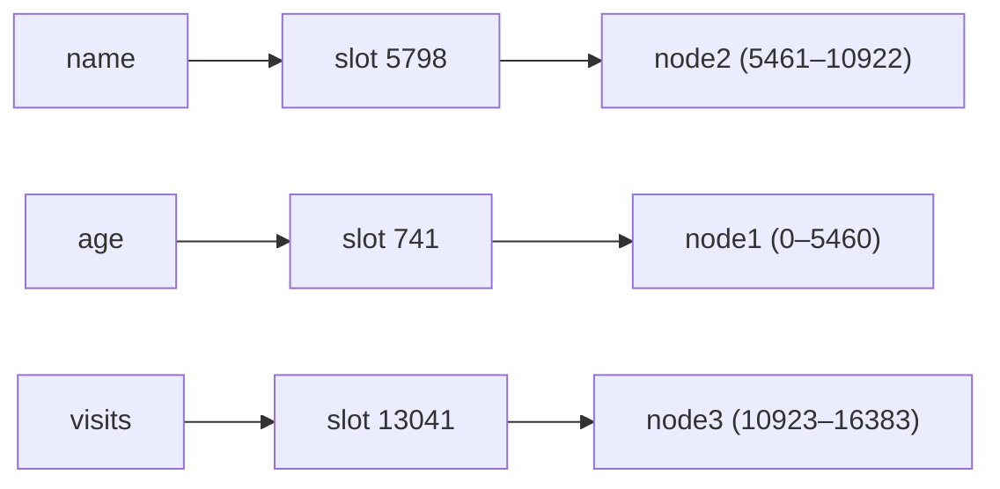
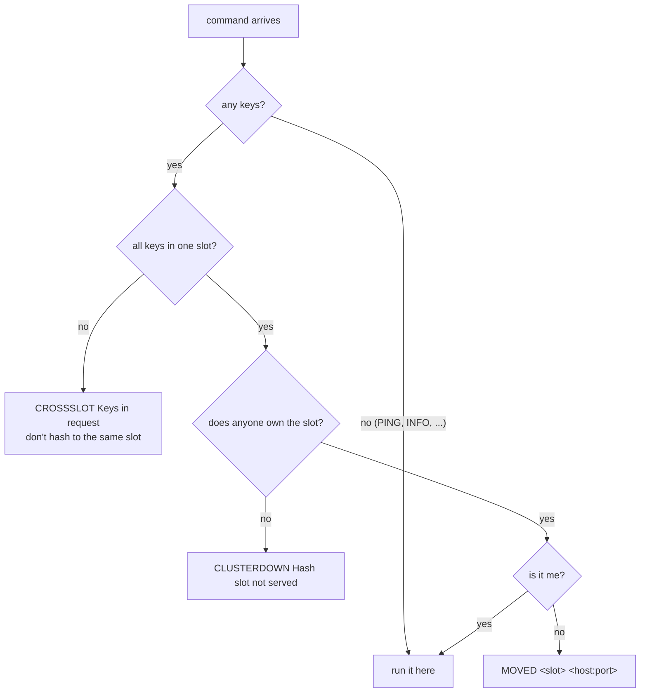

# Cluster mode

In cluster mode, several Rediska nodes split the keys between them, the way
Redis Cluster does. Each node holds only its share, and clients are sent to
the right node.

!!! info "Current scope"
    The cluster layout is **fixed**: every node reads it from a file at
    startup. Nodes don't talk to each other yet, slots can't move while
    running, and there are no replicas. See [Limitations](#limitations).

## Slots

Every key belongs to one of **16384 hash slots**:

```
slot = CRC16(key) mod 16384
```

Each node owns some of the slots, and stores only the keys in them.



There are far more keys than slots, so each slot holds many keys. Slots are
the unit that gets assigned to nodes (and, in a later phase, moved between
them), so the cluster map stays small: 16384 entries, however many keys you
have.

```console
$ redis-cli -p 7001 cluster keyslot name
(integer) 5798
```

### Hash tags

If a key contains `{...}`, only the part inside the braces is hashed. Keys
with the same tag always land in the same slot:

```console
$ redis-cli -p 7001 cluster keyslot {user1}.name
(integer) 8106
$ redis-cli -p 7001 cluster keyslot {user1}.email
(integer) 8106
```

Use hash tags for keys you need to use together in one command or
transaction.

## The layout file

Every node reads the same layout file, which lists every node, its address
and the slots it owns:

```text title="cluster.conf"
# name   address          slots
node1  127.0.0.1:7001  0-5460
node2  127.0.0.1:7002  5461-10922
node3  127.0.0.1:7003  10923-16383
```

- Slots can be ranges (`0-5460`) or single slots (`42`), several per line.
- Anything after `#` is a comment.
- A node finds **its own** line by matching its `--port`.
- Any mistake (overlapping slots, a slot above 16383, a duplicate name or
  address, no line for this node's port) stops the node at startup, naming
  the line.
- Slots that no line lists are *unowned*: commands on them get
  `CLUSTERDOWN`, while every other slot keeps working.

Start each node with the same file and its own port:

```bash
rediska --port 7001 --cluster-enabled --cluster-config-file cluster.conf
rediska --port 7002 --cluster-enabled --cluster-config-file cluster.conf
rediska --port 7003 --cluster-enabled --cluster-config-file cluster.conf
```

### The cluster script

`scripts/cluster.sh` does all of that for you:

```bash
./scripts/cluster.sh start     # build, write the layout, start the nodes
./scripts/cluster.sh status    # which nodes are running, and their key counts
./scripts/cluster.sh stop      # stop them; data stays in each node's AOF
./scripts/cluster.sh clean     # stop and delete all their files
```

Files go in `/tmp/rediska-cluster/`. `NODES=4 ./scripts/cluster.sh start`
starts 4 nodes with the slots split evenly (run `clean` first if you change
the number of nodes).

## How a command is routed

Before running a command, a node checks its keys, in the same order as
Redis:



The error texts match Redis 7 word for word, so clients that understand
Redis Cluster understand Rediska:

```console
$ redis-cli -p 7001 set name vinay
(error) MOVED 5798 127.0.0.1:7002
$ redis-cli -c -p 7001 set name vinay
-> Redirected to slot [5798] located at 127.0.0.1:7002
OK
$ redis-cli -p 7001 del age name
(error) CROSSSLOT Keys in request don't hash to the same slot
```

`redis-cli -c` follows `MOVED` redirects for you. In a pipeline, each
command gets its own reply, in order.

## Transactions

All keys in a `MULTI`/`EXEC` transaction must be in **one slot**, owned by
the node you're connected to. Rediska checks this in two places, as Redis
does:

**While queuing**, each command is checked on its own. If one fails, the
transaction is marked broken and `EXEC` refuses to run anything:

```console
127.0.0.1:7001> multi
OK
127.0.0.1:7001(TX)> set age 30
QUEUED
127.0.0.1:7001(TX)> set name vinay
(error) MOVED 5798 127.0.0.1:7002
127.0.0.1:7001(TX)> exec
(error) EXECABORT Transaction discarded because of previous errors.
```

**At `EXEC`**, all the queued keys are checked together. This catches
commands that are fine on their own but use different slots:

```console
127.0.0.1:7001> multi
OK
127.0.0.1:7001(TX)> set age 30
QUEUED
127.0.0.1:7001(TX)> set foo2 x
QUEUED
127.0.0.1:7001(TX)> exec
(error) CROSSSLOT Keys in request don't hash to the same slot
```

`age` (slot 741) and `foo2` (slot 1044) are both on node1, but in different
slots, so the transaction is refused. Either way, a transaction never runs
halfway. Use hash tags to keep a transaction's keys together:

```console
127.0.0.1:7002> multi
OK
127.0.0.1:7002(TX)> set {user1}.name vinay
QUEUED
127.0.0.1:7002(TX)> incr {user1}.visits
QUEUED
127.0.0.1:7002(TX)> exec
1) OK
2) (integer) 1
```

## CLUSTER commands

| Command | Returns | Used by |
|---|---|---|
| `CLUSTER KEYSLOT key` | the key's slot | debugging |
| `CLUSTER SLOTS` | slot ranges and their owners | client libraries, to learn the map |
| `CLUSTER NODES` | one line per node | `redis-cli --cluster`, `redis-benchmark --cluster` |
| `CLUSTER MYID` | this node's 40-character ID | debugging |
| `CLUSTER INFO` | `cluster_state:ok` if every slot has an owner, plus counts | monitoring |

`INFO cluster` reports `cluster_enabled:1` on a cluster node.

Node IDs are derived from the node's name, so they stay the same across
restarts. Fields that need nodes to talk to each other (ping times, link
state) have fixed values for now.

### Tools that work

- `redis-cli -c`: follows redirects.
- `redis-cli --cluster check 127.0.0.1:7001`: reports all 16384 slots
  covered.
- `redis-benchmark --cluster -p 7001`: spreads load across the nodes.

Some client libraries also need commands Rediska doesn't have yet. For
example, redis-py's cluster client reads the slot map, then calls `COMMAND`.

## Persistence in a cluster

Each node has its own AOF, holding only its own keys. When a node restarts,
it loads its whole AOF back **without** the cluster check, so its data is
never dropped, even if the layout file changed while it was down.

## Limitations

- **Fixed layout**: nodes don't talk to each other; to change the layout,
  edit the file and restart the nodes.
- **No slot migration**: slots can't move between running nodes.
- **No replicas or failover**: if a node goes down, its slots are
  unavailable until it comes back.
- **One machine**: nodes find themselves by port, so all nodes need
  different ports. Running nodes on separate machines (which typically all
  use the same port) needs a `--cluster-node-name` flag, which isn't there
  yet.
